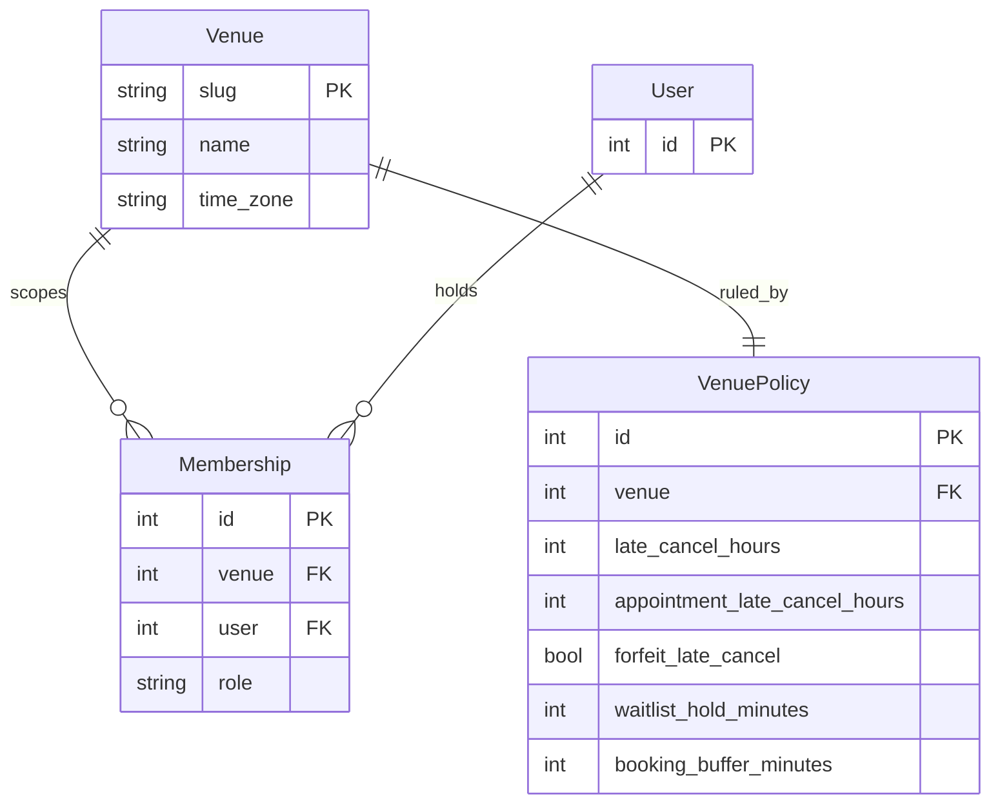
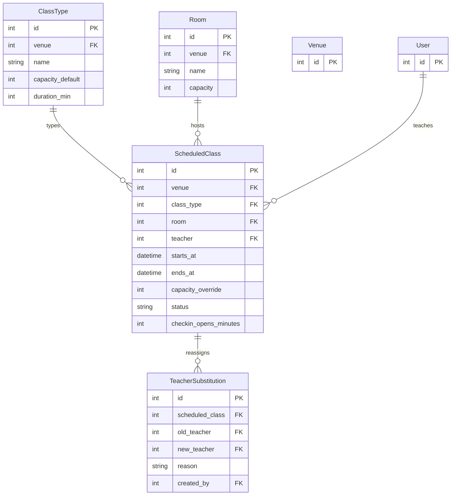
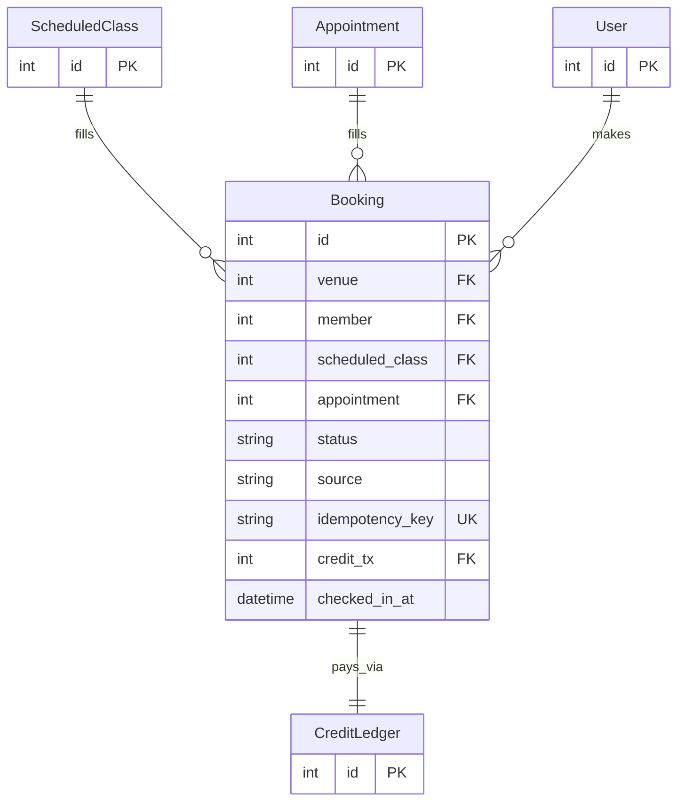
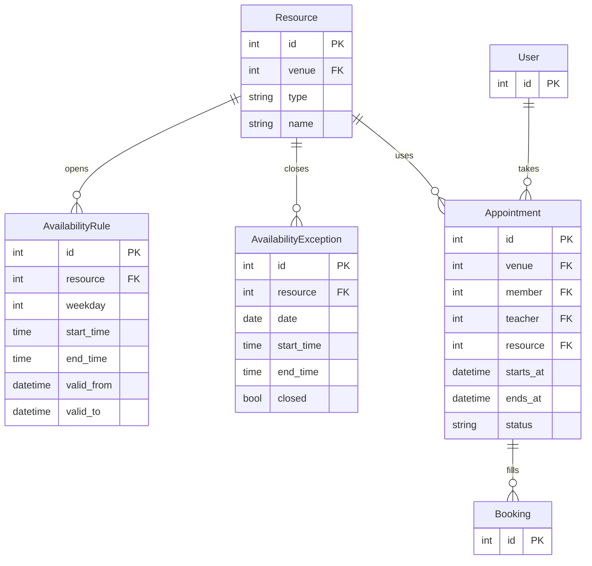
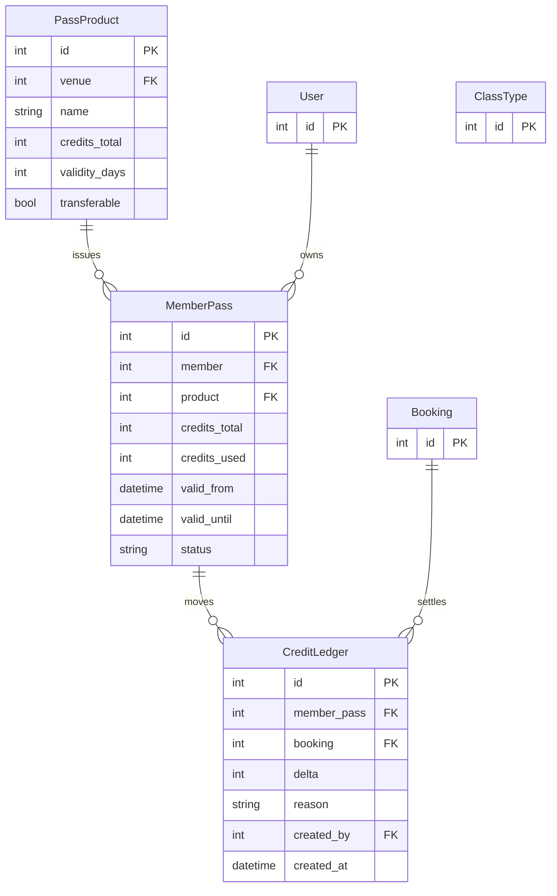
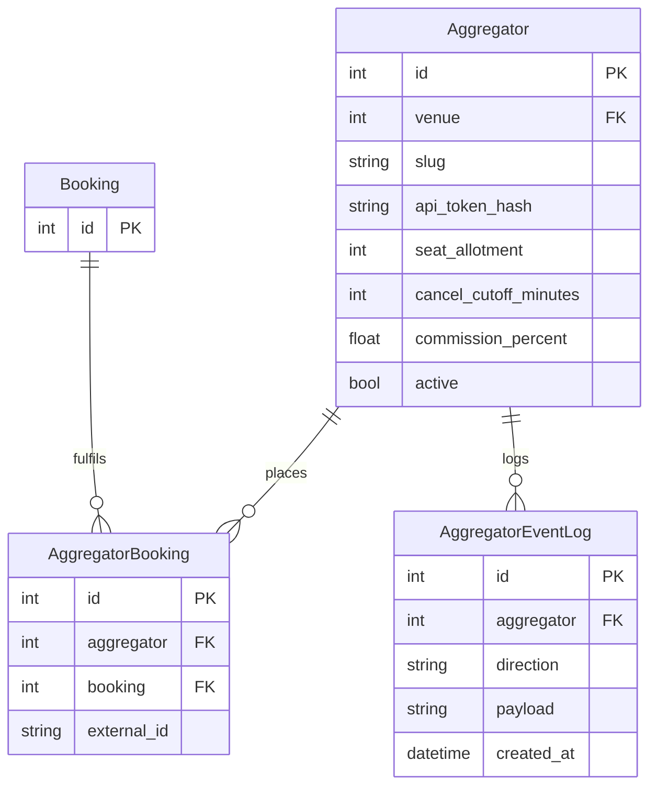
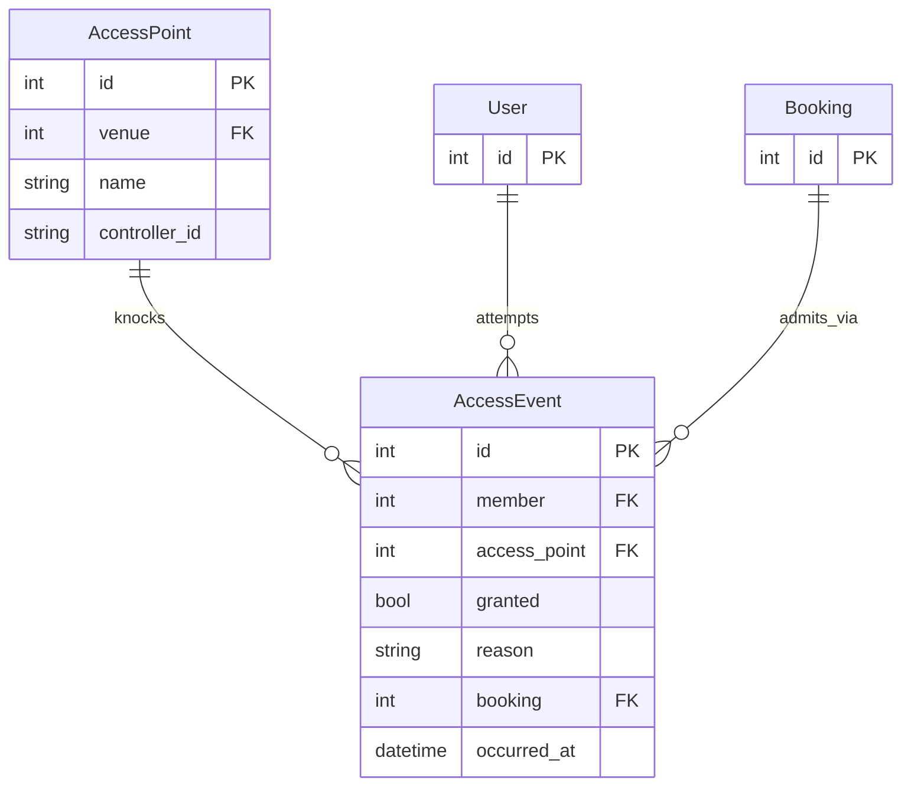

# Bookr — Venue Management Spec

Multi-tenant Django app for individual venues: group classes, 1-1 appointments, passes/credits, aggregator distribution, self-service access control.

## 1. Goals / Non-goals

Goals: one deploy serves many venues (tenant = `Venue`); correct bookings under concurrency; auditable credit ledger; aggregators as just another booking channel; doors open/deny in <500ms.
Non-goals (v1): payments/PSP integration, native mobile apps, dynamic pricing, marketing CRM.

## 2. Tenancy & Roles

- Tenancy: single DB, shared schema, every tenant-scoped row has `venue FK`. Enforce via middleware (`X-Venue-Slug` / staff's venue) + queryset mixin `VenueScopedManager`. No cross-venue FKs. Unique constraints scoped to `(venue, ...)`.
- Roles (per venue): `owner, manager, teacher, frontdesk, member`. Use Django groups + per-object check (`is_teacher_of(class)`). Staff ≠ superuser. Aggregator access via scoped API tokens, never user passwords.

**Data model** (all fields in §3.7):



`User` is Django's auth user — no custom fields in v1. One `VenuePolicy` row per venue (1:1, created with it) — business rules live there, so policy edits never touch identity rows.

## 3. Domain

### 3.1 Scheduling (classes)

Models: `ClassType(name, description, capacity_default, duration_min)`, `Studio/Room(name, capacity)`, `ScheduledClass(class_type, room, teacher, starts_at, ends_at, capacity_override, status: scheduled|cancelled|completed, checkin_opens_minutes=30)`, `TeacherSubstitution(scheduled_class, old_teacher, new_teacher, reason, created_by)` (append-only, keep history).

Rules:
- No double-booked room or teacher: `ExclusionConstraint` on `TSTZRANGE(starts_at, ends_at)` per `(venue, room)` and `(venue, teacher)` where `status != cancelled` (requires Postgres + btree_gist).
- Capacity = override or room capacity or type default (first non-null wins). Capacity edits never kick confirmed bookings; only shrink free seats.
- Class cancellation by staff → auto-refund credits + notify confirmed + promote waitlist in order. Immutable once `completed`.
- Substitution notifies booked members; original teacher record kept.

**Data model** (all fields in §3.7):



Capacity = override → room → type default. `Venue`/`User` summarized here; full definitions in §2.

### 3.2 Bookings, waitlist, late cancels

Models: `Booking(idempotency_key, member, scheduled_class NULL, appointment NULL, status: confirmed|waitlisted|cancelled|no_show|completed, source: app|frontdesk|aggregator:<name>, credit_tx FK, checked_in_at)`; `WaitlistEntry(booking UNIQUE, position)` or derive position by `created_at` — prefer derived, one less counter to corrupt.

Rules:
- One active booking per member per class: `UniqueConstraint(venue, member, scheduled_class) WHERE status IN (confirmed, waitlisted)`.
- Booking is a transaction: `SELECT ... FOR UPDATE` on `ScheduledClass` row (or `select_for_update` on a `SeatCounter`) → check seats → deduct credit → create booking. Serialize per class. Return `409` when full (offer waitlist join in same call via `?waitlist=true`).
- Waitlist promotion FIFO by `created_at`, on cancel/no-show/capacity increase. Promotion holds seat for `waitlist_hold_minutes` (default 60, configurable per venue); expiry passes to next. Promotion runs in Celery task, idempotent on `booking_id`.
- Late-cancel window per venue (default 8h classes, 24h 1-1): cancel inside window → `cancelled_late`, credit forfeited (configurable `forfeit_late_cancel bool`), counts toward no-show strikes. Outside window → refund to ledger. Staff override always refunds with `reason` logged.
- No-show: frontdesk marks within 2h after end → forfeit credit. 3 strikes in 30d → optional booking throttle (flag, don't auto-ban in v1).

**Data model** (all fields in §3.7):



The waitlist has no table — order derives from `Booking.created_at`. A booking targets exactly one of class/appointment.

### 3.3 1-1 appointments & resources

Models: `Resource(type: room|equipment|teacher, name, venue)`, `AvailabilityRule(resource, weekday, start_time, end_time, valid_from, valid_to)`, `AvailabilityException(resource, date, start/end or closed)`, `Appointment(member, teacher, resource NULL, starts_at, ends_at, status)`.

Rules:
- Availability = weekly rules minus exceptions minus existing appointments/classes involving that teacher/resource. Compute in Python (`generate_slots(rule, date)`), never store every slot.
- Same exclusion constraints as classes for `(venue, teacher)` and `(venue, resource)`.
- Buffer time per venue (`booking_buffer_minutes` default 10) pads both sides for conflict checks.
- Calendar display: API returns events for a date range (`GET /api/calendar?from&to&teacher&room`), frontend renders (FullCalendar). Never `SELECT *` — always bounded range, max 31d.

**Data model** (all fields in §3.7):



Slots are computed (rules − exceptions − commitments); there is no slot table.

### 3.4 Passes & credits

Models: `PassProduct(name, credits_total or unlimited, validity_days, applicable_class_types M2M blank=all, transferable=False)`, `MemberPass(member, product, credits_total, credits_used, valid_from, valid_until, status)`, `CreditLedger(pass FK, booking FK NULL, delta, reason: purchase|booking|refund|forfeit|expiry|adjustment, created_by, created_at)` — ledger is append-only, balance = `SUM(delta)`.

Rules:
- Booking consumes exactly 1 credit (v1; keep `credits_cost` column default 1 for later pricing). FIFO: oldest valid pass covering the class type first. Unlimited passes checked before credit ones.
- Expiry via nightly Celery task writes `forfeit/expiry` ledger rows; never delete or mutate `credits_used` directly — always append to ledger and update cached counters in same transaction.
- Refunds append `+1 refund` rows referencing original booking. Staff adjustments require `reason` + staff id (audit).
- Race safety: `select_for_update` on chosen `MemberPass` row during booking.

**Data model** (all fields in §3.7):



`applicable_class_types` is an M2M from product to class type (blank = all). Balance is always `SUM(delta)`.

### 3.5 Aggregators (ClassPass-style)

Models: `Aggregator(name, api_token_hash, seat_allotment, cancel_cutoff_minutes, commission_percent, active)`, `AggregatorBooking(map to Booking.source=aggregator:<name>, external_id UNIQUE per aggregator)`.

Rules:
- Separate API surface: `POST /api/v1/aggregators/<slug>/bookings` with token auth (hashed, per-aggregator, rotatable) + rate limit. Allotment enforced: aggregator bookings per class ≤ `min(allotment, free seats)`.
- Idempotency required: `(aggregator, external_id)` unique; retries with same key return original booking. Webhook/cancel symmetric. Log every inbound request (`AggregatorEventLog`) for reconciliation.
- Availability push: read-only `GET .../schedule?from&to` + optional webhook on class change (Celery, retry with backoff, sign payloads HMAC).
- Aggregator bookings never consume member passes — billed to aggregator account monthly. Late-cancel policy from contract (`cancel_cutoff_minutes` per aggregator) applies instead of venue default.

**Data model** (all fields in §3.7):



`(aggregator, external_id)` is unique — retries return the original.

### 3.6 Access control (self-service doors)

Models: `AccessPoint(name, controller_id, venue)`, `AccessEvent(member NULL, access_point, granted bool, reason, booking_id NULL, occurred_at)`.

Rules:
- Grant iff: active pass OR confirmed booking starting within `[-15min, +class duration]` OR staff role. Deny otherwise, always log.
- Door controllers call `POST /api/access/check` (token auth per controller, p95 <200ms): read-only check, no credit deduction. Cache member validity in Redis (TTL 60s) with DB fallback; fail-closed on DB outage (deny + log) — shortcut: fail-closed only, auto-open on outage is out of scope.
- Anti-passback: same member re-entry within 60s returns prior decision without new event (configurable).

**Data model** (all fields in §3.7):



`AccessEvent.member` is null for unidentified knocks; `booking` is null for pass/staff grants.

### 3.7 Field reference

Every model, every field, grouped by section. `datetime` = tz-aware UTC; `→` = FK with delete rule; enums list all values with the default starred. Relationship diagrams live in each section above.

*§2 — Tenancy & roles*

| Model | Field | Type | Rules / default |
|---|---|---|---|
| Venue | slug | string | unique |
| | name | string(200) | |
| | time_zone | string(64) | default `UTC`, display only |
| VenuePolicy | venue | 1:1→Venue cascade | one row per venue, `related_name="policy"` |
| | late_cancel_hours | int | default 8 |
| | appointment_late_cancel_hours | int | default 24 |
| | forfeit_late_cancel | bool | default true |
| | waitlist_hold_minutes | int | default 60 |
| | booking_buffer_minutes | int | default 10 |
| Membership | venue | fk→Venue cascade | unique together with user |
| | user | fk→User cascade | |
| | role | enum(owner, manager, teacher, frontdesk, *member) | |

*§3.1 — Scheduling*

| Model | Field | Type | Rules / default |
|---|---|---|---|
| ClassType | venue | fk→Venue cascade | unique together with name |
| | name | string(200) | |
| | description | text | default empty |
| | capacity_default | int, null | fallback 2 of 3 |
| | duration_min | int | |
| Room | venue | fk→Venue cascade | unique together with name |
| | name | string(200) | |
| | capacity | int, null | fallback 3 of 3 |
| ScheduledClass | venue | fk→Venue cascade | |
| | class_type | fk→ClassType protect | |
| | room | fk→Room protect | |
| | teacher | fk→User protect | |
| | starts_at / ends_at | datetime | check ends_at > starts_at |
| | capacity_override | int, null | fallback 1 of 3 |
| | status | enum(*scheduled, cancelled, completed) | immutable once completed |
| | checkin_opens_minutes | int | default 30 |
| | ― | exclusion (venue, room) + overlap | where status ≠ cancelled |
| | ― | exclusion (venue, teacher) + overlap | where status ≠ cancelled |
| TeacherSubstitution | scheduled_class | fk→ScheduledClass cascade | append-only |
| | old_teacher / new_teacher | fk→User protect | history kept |
| | reason | string(255) | default empty |
| | created_by | fk→User null, set_null | |

*§3.2 — Bookings*

| Model | Field | Type | Rules / default |
|---|---|---|---|
| Booking | venue | fk→Venue cascade | |
| | member | fk→User cascade | |
| | scheduled_class | fk→ScheduledClass null, cascade | exactly one target set |
| | appointment | fk→Appointment null, cascade | exactly one target set |
| | status | enum(*confirmed, waitlisted, cancelled, cancelled_late, no_show, completed) | |
| | source | string(64) | default `app`; `frontdesk` or `aggregator:<slug>` |
| | idempotency_key | string(64) | unique |
| | credit_tx | fk→CreditLedger null, set_null | |
| | checked_in_at | datetime, null | |
| | ― | unique (venue, member, class) | where confirmed/waitlisted |
| | ― | unique (venue, member, appointment) | where confirmed/waitlisted |

*§3.3 — Appointments & resources*

| Model | Field | Type | Rules / default |
|---|---|---|---|
| Resource | venue | fk→Venue cascade | unique together with name |
| | type | enum(room, equipment, teacher) | |
| | name | string(200) | |
| AvailabilityRule | resource | fk→Resource cascade | |
| | weekday | int | check 0–6 (Mon–Sun) |
| | start_time / end_time | time | check end > start |
| | valid_from / valid_to | datetime, null | null = open-ended |
| AvailabilityException | resource | fk→Resource cascade | unique together with date |
| | date | date | |
| | start_time / end_time | time, null | null + closed = shut all day |
| | closed | bool | default false |
| Appointment | venue | fk→Venue cascade | |
| | member | fk→User cascade | |
| | teacher | fk→User protect | |
| | resource | fk→Resource null, protect | |
| | starts_at / ends_at | datetime | check ends_at > starts_at |
| | status | enum(*scheduled, cancelled, completed) | appt window = `appointment_late_cancel_hours` |
| | ― | exclusion (venue, teacher) + overlap | where status ≠ cancelled |
| | ― | exclusion (venue, resource) + overlap | where status ≠ cancelled |

*§3.4 — Passes & credits*

| Model | Field | Type | Rules / default |
|---|---|---|---|
| PassProduct | venue | fk→Venue cascade | unique together with name |
| | name | string(200) | |
| | credits_total | int, null | NULL = unlimited |
| | validity_days | int | |
| | applicable_class_types | m2m→ClassType, blank | blank = all types |
| | transferable | bool | default false |
| MemberPass | member | fk→User cascade | |
| | product | fk→PassProduct protect | |
| | credits_total | int, null | snapshot at purchase; NULL = unlimited |
| | credits_used | int | default 0; cache only, ledger is truth |
| | valid_from / valid_until | datetime | |
| | status | enum(*active, expired, depleted) | |
| CreditLedger | member_pass | fk→MemberPass protect | (`pass` is reserved in code; never edited, only appended) |
| | booking | fk→Booking null, set_null | |
| | delta | int | check ≠ 0; balance = SUM(delta) |
| | reason | enum(purchase, booking, refund, forfeit, expiry, adjustment) | staff adjustments need staff id + reason |
| | created_by | fk→User null, set_null | |
| | created_at | datetime | auto, immutable |

*§3.5 — Aggregators*

| Model | Field | Type | Rules / default |
|---|---|---|---|
| Aggregator | venue | fk→Venue cascade | unique together with slug |
| | name | string(200) | |
| | slug | slug | |
| | api_token_hash | string(128) | hashed, rotatable; never a user password |
| | seat_allotment | int | enforced as min(allotment, free seats) |
| | cancel_cutoff_minutes | int | contract late-cancel window |
| | commission_percent | decimal(5,2) | default 0 |
| | active | bool | default true |
| AggregatorBooking | aggregator | fk→Aggregator cascade | unique together with external_id |
| | booking | 1:1→Booking cascade | billed to aggregator, never member passes |
| | external_id | string(128) | partner reference; retries return original |
| | created_at | datetime | auto |
| AggregatorEventLog | aggregator | fk→Aggregator cascade | |
| | direction | enum(inbound, outbound) | |
| | payload | json | default `{}` |
| | created_at | datetime | auto |

*§3.6 — Access control*

| Model | Field | Type | Rules / default |
|---|---|---|---|
| AccessPoint | venue | fk→Venue cascade | unique together with controller_id |
| | name | string(200) | |
| | controller_id | string(128) | per-device token auth |
| AccessEvent | member | fk→User null, set_null | null = unidentified knock |
| | access_point | fk→AccessPoint cascade | indexed with occurred_at |
| | granted | bool | fail-closed on outage |
| | reason | string(255) | default empty; always logged |
| | booking | fk→Booking null, set_null | set for booking-window grants |
| | occurred_at | datetime | auto |

## 4. API & Project Layout

- Django 6.1 + DRF for `/api/*` (Python 3.14+, per `pyproject.toml`), `djangorestframework-simplejwt` (app) + token auth (aggregators/controllers). Versioned: `/api/v1/`. OpenAPI via `drf-spectacular`, breaking change = new version.
- Proposed layout (`django-admin startproject config .`; virtual uv project, no `src/` build — Django apps live at the repo root):
  ```
  manage.py  config/ (settings/, urls.py)  venues/ scheduling/ bookings/ passes/ aggregators/ access/
  ```
  One app per §3 section. Cross-app imports only via services (`bookings/services.py::book_seat()`), never model-to-model shortcuts.
- Settings: `django-environ`, split `base/dev/prod`; Postgres via `psycopg` v3 + `pgcrypto/btree_gist`; Redis (cache + Celery broker); generated defaults kept (`USE_TZ = True`, `TIME_ZONE = 'UTC'`), `time_zone` per venue display-only, store all datetimes UTC.
- Background: Celery + Beat — waitlist promotion, expiry sweeps, aggregator webhooks, reminders/notifications (email/SMS via pluggable backend, templates per venue).
- Money-adjacent discipline: ledger append-only, `select_for_update` on booking paths, `idempotency_key` unique on `Booking`, admin actions logged (`LogEntry` + `reason`).

## 5. Quality Bar

### Django best practices
- Fat services/models, thin views: no business logic in views/serializers; services raise typed errors (`SeatFull`, `CreditInsufficient`), views map to status codes.
- Validation at trust boundary: serializers validate; constraints (`Check/Unique/Exclusion`) enforce at DB as backstop. `select_related/prefetch_related` everywhere list-shaped; assert `assertNumQueries` in list tests.
- AuthZ: `IsAuthenticated` + per-venue permission class (`IsVenueMember`) on every viewset; tests hit cross-venue access (must 404, not 403, to avoid id leaks).
- Migrations: generated, reviewed, `sqlmigrate` for exclusion constraints; data migrations batched. Never `RunPython` without reverse.
- Observability: structured logs with `venue_id/booking_id`, Sentry, `/healthz`, Prometheus metrics (`bookings_total{status}`, `door_grants_total`).

### Testing
- Unit (pytest-django + factory-boy, fast, no I/O): service functions — FIFO pass deduction, late-cancel forfeit vs refund boundary (±1 min), waitlist ordering, availability math (DST edge), allotment enforcement. Target ≥80% on `services.py`/ledger.
- Concurrency test (required, not optional): `ThreadPoolExecutor` N threads booking last seat → exactly 1 confirmed, N-1 waitlisted/409. Same for double-credit-spend.
- API tests (DRF APITestCase): happy path + 409 full + idempotent retry + cross-venue isolation + aggregator token scope.
- E2E (Playwright, few but real): member books → waitlisted → staff cancels seat → member promoted + email received (mailpit); late cancel forfeits credit visible in ledger; door check grants/denies. Run in CI against the running app (web/worker processes plus docker-run db, redis, mailpit); tag `@e2e`, nightly + pre-release, not per-commit if slow.
- CI: `ruff + black --check, mypy (services/models), pytest -x, playwright @smoke`. Seed demo venue via management command for local dev.

## 6. Build Order

1. venues+auth (memberships live in `venues`), 2. classes+booking tx + tests, 3. waitlist/late-cancel + Celery, 4. passes/ledger, 5. appointments/availability+calendar, 6. access control. Ship 1–4 as MVP; validate the single-venue product (1–6) before phase 2: 7. aggregators (advanced — earns its place only on a proven core).
